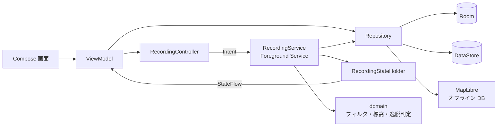

# 🏔️ トレイルログ（TrailLog） — Android 登山アプリ（MVP）

[](../../actions/workflows/android-ci.yml)

圏外の山中でも **現在地とルートが分かり、行動の記録が確実に残る** ことを目指した Android 向け登山アプリです。
要件は [docs/requirements.md](docs/requirements.md)（要件定義書）にまとめています。

> [!WARNING]
> 本アプリの地図・GPS 情報には誤差が含まれます。登山の際は紙の地図・コンパスを併用し、ご自身の判断で行動してください。

---

## 📑 目次

- [機能](#-機能)
- [技術スタック](#-技術スタック)
- [アーキテクチャ](#-アーキテクチャ)
- [ビルドと実行](#-ビルドと実行)
- [CI（GitHub Actions）](#-cigithub-actions)
- [要件との対応](#-要件との対応)
- [実機で確認が必要なこと](#-実機で確認が必要なこと)
- [地図データとライセンス](#-地図データとライセンス)

---

## ✅ 機能

| 機能群 | 主な内容 |
|---|---|
| 地図表示 | 地理院タイル（標準地図・航空写真）、現在地（精度円・向き）、北固定 ／ 進行方向固定、縮尺バー、座標、出典表示 |
| オフライン地図 | 矩形またはルート周辺を指定してダウンロード、推定容量の表示、中断・再開、アプリを閉じても継続、一覧・削除 |
| GPS 軌跡記録 | Foreground Service による記録、1 点ずつ DB へ保存、クラッシュ・再起動後の復元、記録間隔 3 段階、ノイズ除去、静止中の間引き |
| リアルタイム情報 | 経過時間・距離・標高（気圧センサー併用）・累積の登り下り・電池残量・軌跡の描画 |
| ルート | GPX（1.0 / 1.1、trk / rte）の読み込み、地図に重ねて表示、逸脱・復帰の通知と振動 |
| 活動記録 | 一覧、詳細（軌跡・統計・標高グラフ）、位置付き写真とピン表示、タイトル・メモ編集、削除、GPX 1.1 で書き出し・共有、ルートとして再利用 |
| 安全 | 現在地の共有・座標コピー、登山計画書（コンパス）へのリンク、初回の免責事項への同意、電池残量の低下通知 |
| 設定 | 記録間隔、逸脱警告の ON/OFF・距離、画面の常時点灯、地図の種類、規約・プライバシーポリシー・ライセンス・バージョン |

---

## 🛠 技術スタック

| 領域 | 採用技術 |
|---|---|
| 言語 | Kotlin 2.3（AGP 9 の組み込み Kotlin） |
| UI | Jetpack Compose / Material 3 |
| アーキテクチャ | MVVM + Repository |
| DI | Hilt |
| 地図 | MapLibre Native Android 13（OpenGL ES 版 `android-sdk-opengl`） |
| 位置情報 | FusedLocationProviderClient（Google Play services） |
| DB / 設定 | Room / DataStore |
| 非同期 | Kotlin Coroutines / Flow |
| バックグラウンド | Foreground Service（記録）／ WorkManager（地図ダウンロード） |
| GPX | 自前の SAX パーサーとライター（追加ライブラリなし） |
| CI | GitHub Actions（ユニットテスト・Lint・デバッグ APK） |

ライブラリのバージョンは [gradle/libs.versions.toml](gradle/libs.versions.toml) で一括管理し、Dependabot で更新を検知します。

---

## 🧱 アーキテクチャ

```
app/src/main/java/com/example/traillog/
├── domain/        # Android に依存しない計算（距離・標高・逸脱判定・フィルタ・タイル計算）
├── data/
│   ├── db/        # Room（Activity, TrackPoint, Photo, Route, RoutePoint）
│   ├── gpx/       # GPX の読み込み・書き出し
│   ├── location/  # 画面表示中だけの現在地取得
│   ├── map/       # 地図スタイル、オフライン地図、ダウンロード用ワーカー
│   ├── repository/
│   └── settings/  # DataStore
├── service/       # 記録用 Foreground Service、通知、気圧センサー、記録状態の共有
├── di/            # Hilt モジュール
└── ui/            # Compose 画面と ViewModel（SCR-01〜SCR-10）
```



記録の確実性のための設計：

- 位置は 1 点ごとに Room に書き込みます。プロセスが強制終了されても、直前までの点が残ります。
- 活動の状態（記録中 ／ 一時停止中）を DB に持ち、次回起動時に「再開」か「終了して保存」を選べます。
- `ACCESS_BACKGROUND_LOCATION` は使わず、利用者の操作で開始した Foreground Service（type=location）で記録します。

---

## 🚀 ビルドと実行

必要なもの：Android Studio（最新の安定版。AGP 9.4 に対応するもの）、JDK 17 以上。

```bash
git clone https://github.com/<your-account>/<repo-name>.git
cd <repo-name>
./gradlew assembleDebug          # デバッグ APK
./gradlew testDebugUnitTest      # ユニットテスト
```

> [!TIP]
> GPS 記録のテストには実機が必要です。エミュレータでは Extended Controls → Location から GPX を再生して、疑似的に確認できます。

公開前に変更が必要なもの：

- `applicationId` / `namespace`（`com.example.traillog`）とアプリ名（`res/values/strings.xml`）
- 利用規約・プライバシーポリシーの本文（`ui/settings/LegalTexts.kt`）
- リリースビルドの署名設定と、難読化（`isMinifyEnabled`）の有効化

---

## 🤖 CI（GitHub Actions）

[.github/workflows/android-ci.yml](.github/workflows/android-ci.yml) が、`main` への push と Pull Request ごとに次を実行します。

1. Gradle Wrapper の検証
2. ユニットテスト（`testDebugUnitTest`）
3. Lint（`lintDebug`。結果はレポートとして保存し、ビルドは止めない）
4. デバッグ APK のビルドと、成果物としてのアップロード

---

## 🔗 要件との対応

| 要件 | 主な実装 |
|---|---|
| F1 地図表示（FR-MAP-01〜09） | `ui/common/MapLibreView.kt`, `ui/common/MapOverlays.kt`, `ui/map/MapScreen.kt`, `assets/styles/*.json` |
| F2 オフライン地図（FR-OFF-01〜10） | `data/map/OfflineMapRepository.kt`, `data/map/OfflineDownloadWorker.kt`, `ui/offline/*` |
| F3 GPS 軌跡記録（FR-REC-01〜12） | `service/RecordingService.kt`, `domain/LocationFilter.kt`, `ui/common/Intents.kt`（BatteryGuide）, `ui/save/*` |
| F4 リアルタイム情報（FR-STA-01〜07） | `service/RecordingStateHolder.kt`, `domain/TrackAccumulator.kt`, `domain/AltitudeFuser.kt`, `ui/map/RecordingPanel.kt` |
| F5 ルート・逸脱警告（FR-RTE-01〜07） | `data/gpx/*`, `data/repository/RouteRepository.kt`, `domain/DeviationDetector.kt`, `ui/route/*` |
| F6 活動記録（FR-ACT-01〜10） | `data/repository/ActivityRepository.kt`, `ui/activity/*`, `ui/common/Photos.kt` |
| F7 安全機能（FR-SAF-01〜05） | `ui/common/Intents.kt`, `ui/disclaimer/*`, `service/NotificationHelper.kt` |
| F8 設定（FR-SET-01〜05） | `data/settings/SettingsRepository.kt`, `ui/settings/*` |
| 画面 SCR-01〜SCR-10 | `MainActivity.kt`（SCR-01）, `ui/navigation/AppNavHost.kt`（SCR-02〜10） |
| データ 7.1〜7.3 | `data/db/*`, `res/xml/*backup*`（クラウドバックアップから記録・写真を除外） |
| NFR-MNT-02 ユニットテスト | `app/src/test/`（距離・標高・逸脱判定・フィルタ・タイル計算・GPX 入出力） |
| NFR-MNT-03 Migration | `AppDatabase.MIGRATIONS`、スキーマは `app/schemas/` に出力 |

補足：

- FR-OFF-10（未取得範囲の表示）は、未取得のタイルを灰色の背景で表示し、オフライン時に案内を出す形で実装しています。
- 標高は、Android 14 以降では端末の機能で海抜高度に変換します。Android 13 以前は GPS の楕円体高になるため、日本では 30〜40 m ほど高めに出ることがあります（気圧センサーがある端末では相対的な変化は正確です）。

---

## 🧪 実機で確認が必要なこと

次の項目は、コードだけでは確認できません。リリース前に実機・実地で検証してください（要件定義書 11 章）。

- [ ] AC-02：機内モードでの地図表示・現在地・記録・逸脱警告
- [ ] AC-03：6 時間以上の実際の登山で記録が途切れないこと（3 機種以上）
- [ ] AC-04 / AC-05：強制終了・端末再起動からの復元
- [ ] AC-07：画面オフ時の逸脱警告（通知と振動）
- [ ] AC-08：電池消費（NFR-BAT-01, 02）と 10 時間連続記録（NFR-REL-01）
- [ ] AC-09：Google Play の位置情報・Foreground Service の申告、データセーフティ

---

## 📜 地図データとライセンス

| データ | 提供元 | 利用条件 |
|---|---|---|
| 地形図・航空写真タイル | [国土地理院 地理院タイル](https://maps.gsi.go.jp/development/ichiran.html) | 出典を明示すれば利用可（[利用規約](https://www.gsi.go.jp/kikakuchousei/kikakuchousei40182.html)） |

> [!IMPORTANT]
> 提供元への負荷を抑えるため、1 回のダウンロードは 60,000 タイルまでに制限しています。OpenStreetMap 公式のタイルサーバーは一括ダウンロードを禁止しているため、使用していません。

アプリ本体のライセンスは未定です（例：MIT License）。利用するライブラリには、それぞれのライセンスが適用されます。
