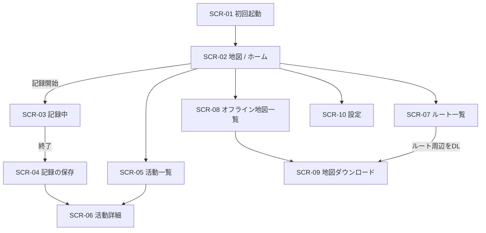
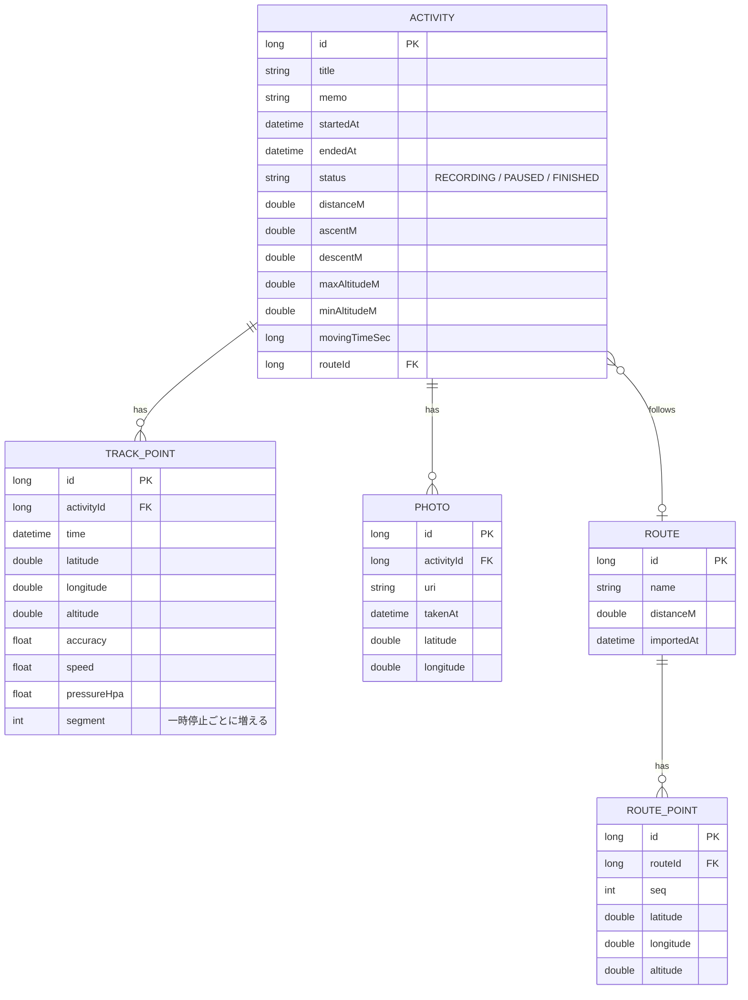

# 要件定義書：Android 登山アプリ（MVP）

| 項目 | 内容 |
|---|---|
| 文書名 | Android 登山アプリ（MVP）要件定義書 |
| 版数 | 1.0 |
| 作成日 | 2026-10-17 |
| 作成者 | (氏名) |
| ステータス | ドラフト |

---

## 目次

1. [はじめに](#1-はじめに)
2. [システム概要](#2-システム概要)
3. [利用者と利用シーン](#3-利用者と利用シーン)
4. [機能要件](#4-機能要件)
5. [非機能要件](#5-非機能要件)
6. [画面要件](#6-画面要件)
7. [データ要件](#7-データ要件)
8. [外部インターフェース要件](#8-外部インターフェース要件)
9. [制約条件・前提条件](#9-制約条件前提条件)
10. [スコープ外](#10-スコープ外)
11. [受け入れ基準](#11-受け入れ基準)
12. [リスクと対策](#12-リスクと対策)
13. [用語集](#13-用語集)
14. [改訂履歴](#14-改訂履歴)

---

## 1. はじめに

### 1.1 目的

本書は、Android 向け登山アプリの MVP（Minimum Viable Product）で実現すべき要件を定義する。開発・テスト・リリース判定の基準として用いる。

### 1.2 背景

山中の多くは携帯電話の圏外であり、道迷いは山岳遭難の主な原因の一つである。既存サービス（YAMAP、ヤマレコ等）と同様に、スマートフォンの GPS とオフライン地図を使い、登山者が自分の現在地を把握し、行動記録を残せる仕組みを提供する。

### 1.3 MVP のゴール

> **圏外の山中で、自分の現在地とルートが分かり、行動の記録が確実に残ること**

### 1.4 要件の優先度

| 優先度 | 意味 |
|---|---|
| **Must** | MVP リリースに必須。欠けるとリリースできない |
| **Should** | MVP に含めることが強く望ましい。工数次第で次版へ回してよい |
| **Could** | 余裕があれば実装する |

---

## 2. システム概要

### 2.1 システム構成

MVP は **端末内で完結するスタンドアロンアプリ** とする。独自のサーバーは持たない。

```
┌───────────────────────────────┐
│        Android アプリ          │
│  ┌──────┐ ┌──────┐ ┌──────┐   │
│  │ UI   │ │記録   │ │地図   │   │
│  │      │ │Service│ │タイル │   │
│  └──┬───┘ └──┬───┘ └──┬───┘   │
│     └────────┼────────┘       │
│          ┌───┴───┐            │
│          │ Room  │ ローカルDB  │
│          └───────┘            │
└───────┬───────────────┬───────┘
        │               │
   GPS / 気圧センサー    地理院タイル（通信時のみ）
```

### 2.2 主な機能

| No. | 機能群 | 概要 |
|---|---|---|
| F1 | 地図表示 | 等高線付きの地形図と現在地を表示する |
| F2 | オフライン地図 | 地図を事前にダウンロードし、圏外で使う |
| F3 | GPS 軌跡記録 | 登山中の位置を継続して記録する |
| F4 | リアルタイム情報 | 記録中の時間・距離・標高を表示する |
| F5 | ルート表示・逸脱警告 | 予定ルートを表示し、逸脱を警告する |
| F6 | 活動記録管理 | 過去の記録を閲覧・編集・エクスポートする |
| F7 | 安全機能 | 現在地の共有、免責事項への同意 |
| F8 | 設定 | 記録間隔や警告の設定 |

---

## 3. 利用者と利用シーン

### 3.1 想定利用者

| 区分 | 特徴 |
|---|---|
| 主対象 | 日帰り〜1 泊程度の登山・ハイキングを行う一般登山者 |
| 副対象 | 登山初心者（道迷いへの不安が大きい層） |

### 3.2 利用シーン（ユーザーストーリー）

| ID | ユーザーストーリー |
|---|---|
| US-01 | 登山者として、**出発前に**登る山の地図をダウンロードしておき、圏外でも地図を見たい |
| US-02 | 登山者として、**出発前に**予定ルート（GPX）を読み込み、地図上に表示しておきたい |
| US-03 | 登山者として、**登山口で**記録を開始し、スマホをポケットに入れたまま記録を続けたい |
| US-04 | 登山者として、**登山中に**現在地・標高・経過時間を確認したい |
| US-05 | 登山者として、**道を外れたら**すぐに気づけるよう、警告を受けたい |
| US-06 | 登山者として、**緊急時に**現在地を家族や救助機関に伝えたい |
| US-07 | 登山者として、**下山後に**軌跡・標高グラフ・写真を振り返りたい |
| US-08 | 登山者として、記録を GPX で書き出し、他のサービスでも使いたい |

---

## 4. 機能要件

### F1. 地図表示

| ID | 要件 | 優先度 |
|---|---|---|
| FR-MAP-01 | 等高線付きの地形図（地理院タイル「標準地図」）を表示できること | Must |
| FR-MAP-02 | ピンチ操作で拡大・縮小、ドラッグでスクロール、2 本指で回転できること | Must |
| FR-MAP-03 | 現在地を、精度円と端末の向きとともに地図上に表示できること | Must |
| FR-MAP-04 | 現在地を地図の中央に戻すボタンがあること | Must |
| FR-MAP-05 | 表示モードを「北を上に固定」と「進行方向を上に固定」で切り替えられること | Should |
| FR-MAP-06 | 縮尺バーを表示すること | Must |
| FR-MAP-07 | 現在地の緯度経度を表示できること | Must |
| FR-MAP-08 | 地図データの出典を画面上に常に表示すること | Must |
| FR-MAP-09 | 地図の種類を切り替えられること（標準地図 ／ 航空写真など） | Could |

### F2. オフライン地図

| ID | 要件 | 優先度 |
|---|---|---|
| FR-OFF-01 | 地図上で矩形の範囲を指定し、その範囲のタイルを一括ダウンロードできること | Must |
| FR-OFF-02 | ダウンロード前に、推定のタイル数と容量を表示すること | Must |
| FR-OFF-03 | ダウンロード対象のズームレベルの範囲を指定できること（初期値：10〜16） | Should |
| FR-OFF-04 | 読み込んだルートの周辺（指定幅）を自動でダウンロードできること | Should |
| FR-OFF-05 | ダウンロードの進捗を表示し、中断・再開ができること | Must |
| FR-OFF-06 | アプリを閉じてもダウンロードが継続すること | Must |
| FR-OFF-07 | ダウンロード済みの地図を一覧表示し、名称・範囲・容量・取得日を確認できること | Must |
| FR-OFF-08 | ダウンロード済みの地図を削除できること | Must |
| FR-OFF-09 | 通信がない状態で、保存済みのタイルだけを使って地図を表示できること | Must |
| FR-OFF-10 | 保存済みでない範囲は、未取得であることが分かる表示にすること | Should |

### F3. GPS 軌跡記録

| ID | 要件 | 優先度 |
|---|---|---|
| FR-REC-01 | 記録を開始・一時停止・再開・終了できること | Must |
| FR-REC-02 | 記録中は常駐通知を表示し、画面オフやアプリのバックグラウンド化の後も記録を継続すること | Must |
| FR-REC-03 | 常駐通知から、記録の一時停止・再開ができること | Should |
| FR-REC-04 | 取得した位置を 1 点ごとに DB へ保存すること（終了時にまとめて保存しない） | Must |
| FR-REC-05 | アプリのクラッシュや端末の再起動が起きた後、次回起動時に記録中だった活動を検出し、再開または終了を選べること | Must |
| FR-REC-06 | 記録間隔を 3 段階から選べること（高精度：約 3 秒 ／ 標準：約 10 秒 ／ 省電力：約 30 秒） | Must |
| FR-REC-07 | 精度（accuracy）がしきい値（初期値 50 m）より悪い点を記録から除外すること | Must |
| FR-REC-08 | 前の点からの速度が異常値（初期値：時速 30 km 超）となる点を除外すること | Must |
| FR-REC-09 | 一定時間（初期値 5 分）以上、位置がほぼ動かない場合は記録点を間引くこと | Should |
| FR-REC-10 | 初回の記録開始時に、バッテリー最適化を除外する設定を案内すること | Must |
| FR-REC-11 | メーカー独自の省電力機能について、端末ごとの設定方法を案内すること | Should |
| FR-REC-12 | 記録の終了時に、タイトル（初期値：日付）を入力して保存できること | Must |

### F4. 記録中のリアルタイム情報

| ID | 要件 | 優先度 |
|---|---|---|
| FR-STA-01 | 経過時間（一時停止中の時間を除く）を表示すること | Must |
| FR-STA-02 | 移動距離を表示すること | Must |
| FR-STA-03 | 現在の標高を表示すること | Must |
| FR-STA-04 | 気圧センサーを搭載した端末では、気圧と GPS 高度を組み合わせて標高を算出すること | Should |
| FR-STA-05 | 累積の登り（獲得標高）と下りを表示すること。細かな上下の変動は、しきい値（初期値 5 m）で平滑化すること | Must |
| FR-STA-06 | 地図上に、記録中の軌跡をリアルタイムで描画すること | Must |
| FR-STA-07 | 端末の電池残量を表示すること | Could |

### F5. ルート表示・逸脱警告

| ID | 要件 | 優先度 |
|---|---|---|
| FR-RTE-01 | GPX ファイル（trk ／ rte 要素）をインポートできること | Must |
| FR-RTE-02 | インポートしたルートを一覧表示し、削除できること | Must |
| FR-RTE-03 | 選んだルートを地図上に重ねて表示できること | Must |
| FR-RTE-04 | 記録中、現在地とルートの最短距離がしきい値（初期値 50 m）を一定時間（初期値 30 秒）以上超えたとき、通知と振動で警告すること | Must |
| FR-RTE-05 | ルートに復帰したことを通知すること | Should |
| FR-RTE-06 | 逸脱警告の ON/OFF としきい値を設定で変更できること | Must |
| FR-RTE-07 | 不正な形式の GPX を読み込んだときは、エラーメッセージを表示すること | Must |

### F6. 活動記録の閲覧・管理

| ID | 要件 | 優先度 |
|---|---|---|
| FR-ACT-01 | 保存した活動を、日付の新しい順に一覧表示すること（日付・タイトル・距離・時間） | Must |
| FR-ACT-02 | 活動の詳細画面で、軌跡を地図上に表示すること | Must |
| FR-ACT-03 | 活動の詳細画面で、統計（時間・距離・累積の登り下り・最高標高・最低標高）を表示すること | Must |
| FR-ACT-04 | 活動の詳細画面で、標高グラフ（横軸：距離または時間）を表示すること | Must |
| FR-ACT-05 | 記録中に写真を撮影または選択して、撮影位置とともに保存できること | Should |
| FR-ACT-06 | 写真を地図上にピンで表示し、タップで拡大表示できること | Should |
| FR-ACT-07 | 活動のタイトルとメモを編集できること | Must |
| FR-ACT-08 | 活動を削除できること（確認ダイアログを表示する） | Must |
| FR-ACT-09 | 活動を GPX 1.1 形式でエクスポートし、Android の共有機能で他アプリへ渡せること | Must |
| FR-ACT-10 | 活動の軌跡を、新しい予定ルートとして再利用できること | Could |

### F7. 安全機能

| ID | 要件 | 優先度 |
|---|---|---|
| FR-SAF-01 | 現在地の緯度経度と地図リンクを、Android の共有機能で送信できること | Must |
| FR-SAF-02 | 現在地の緯度経度をクリップボードにコピーできること | Must |
| FR-SAF-03 | 登山計画書の提出サービス（コンパス等）の Web ページを開くリンクを設けること | Should |
| FR-SAF-04 | 初回起動時に免責事項を表示し、同意しない限り利用を開始できないこと | Must |
| FR-SAF-05 | 記録中に電池残量が少なくなったとき（初期値 20%）に通知すること | Should |

### F8. 設定

| ID | 要件 | 優先度 |
|---|---|---|
| FR-SET-01 | 記録間隔（高精度 ／ 標準 ／ 省電力）を設定できること | Must |
| FR-SET-02 | 距離と標高の単位（km ／ m）を表示すること | Must |
| FR-SET-03 | ルート逸脱警告の ON/OFF と距離のしきい値を設定できること | Must |
| FR-SET-04 | 記録中に画面を常時点灯するかどうかを設定できること | Should |
| FR-SET-05 | アプリのバージョン、利用規約、プライバシーポリシー、ライセンス表示を確認できること | Must |

---

## 5. 非機能要件

> [!NOTE]
> 本章の数値は MVP 時点の **目標値** である。実地テストの結果を踏まえて見直す。

### 5.1 性能

| ID | 要件 |
|---|---|
| NFR-PRF-01 | アプリの起動から地図表示までを 3 秒以内とする（中位機種、コールドスタート） |
| NFR-PRF-02 | 地図の操作（スクロール・拡大）を 30 fps 以上で描画する |
| NFR-PRF-03 | 10,000 点の軌跡を含む活動の詳細画面を 2 秒以内に表示する |
| NFR-PRF-04 | 記録の開始操作から、最初の位置を記録するまでを 30 秒以内とする（屋外で空が開けた環境） |

### 5.2 消費電力

| ID | 要件 |
|---|---|
| NFR-BAT-01 | 標準モードで記録し、画面をオフにした状態での電池消費を 1 時間あたり 5% 以下とする |
| NFR-BAT-02 | 省電力モードでの電池消費を 1 時間あたり 3% 以下とする |
| NFR-BAT-03 | 記録していないときは、位置情報の取得を完全に停止する |

### 5.3 信頼性

| ID | 要件 |
|---|---|
| NFR-REL-01 | 10 時間連続で記録しても、記録の欠損やクラッシュが起きないこと |
| NFR-REL-02 | アプリが強制終了されても、強制終了の直前までの記録点が失われないこと |
| NFR-REL-03 | 端末のストレージが不足したときは、記録を止めずに警告を表示すること |
| NFR-REL-04 | クラッシュフリー率を 99.5% 以上とする |

### 5.4 精度

| ID | 要件 |
|---|---|
| NFR-ACC-01 | 移動距離の誤差を、既知のルートに対して ±5% 以内とする |
| NFR-ACC-02 | 累積の登りの誤差を、既知のルートに対して ±10% 以内とする |

### 5.5 ユーザビリティ

| ID | 要件 |
|---|---|
| NFR-USA-01 | 記録の開始は、ホーム画面から 2 タップ以内で行えること |
| NFR-USA-02 | 主要なボタンは、手袋をしたまま操作しやすい大きさ（48dp 以上）とすること |
| NFR-USA-03 | 直射日光の下でも読めるよう、十分なコントラストを確保すること |
| NFR-USA-04 | ダークテーマに対応すること |
| NFR-USA-05 | 表示言語は日本語とする（MVP） |

### 5.6 セキュリティ・プライバシー

| ID | 要件 |
|---|---|
| NFR-SEC-01 | 位置情報と活動記録は端末内にのみ保存し、外部へ自動で送信しないこと |
| NFR-SEC-02 | 位置情報は、ユーザーが明示的に共有またはエクスポートした場合にのみ外部へ渡すこと |
| NFR-SEC-03 | 各権限は、必要になった時点で利用目的を説明してから要求すること |
| NFR-SEC-04 | 権限が拒否されても、アプリがクラッシュせず、制限付きで動作すること |
| NFR-SEC-05 | 端末のバックアップ機能（Auto Backup）の対象に含めるかどうかを明示的に設定すること |

### 5.7 互換性

| ID | 要件 |
|---|---|
| NFR-CMP-01 | Android 8.0（API 26）以上で動作すること |
| NFR-CMP-02 | targetSdk は、Google Play が要求する最新の API レベルとすること |
| NFR-CMP-03 | 画面サイズ 5〜7 インチのスマートフォンで、表示が崩れないこと |
| NFR-CMP-04 | 主要メーカー（Google、Samsung、Sony、Sharp、Xiaomi など）の端末で記録の継続を確認すること |

### 5.8 保守性

| ID | 要件 |
|---|---|
| NFR-MNT-01 | MVVM + Repository パターンで、UI ／ ドメイン ／ データ層を分離すること |
| NFR-MNT-02 | 距離計算、標高の平滑化、逸脱判定などのロジックにユニットテストを用意すること |
| NFR-MNT-03 | DB スキーマの変更時は、Room の Migration でデータを引き継ぐこと |

---

## 6. 画面要件

### 6.1 画面一覧

| ID | 画面名 | 主な要素 | 関連要件 |
|---|---|---|---|
| SCR-01 | 初回起動 | 免責事項、同意ボタン、権限の説明 | FR-SAF-04 |
| SCR-02 | 地図（ホーム） | 地図、現在地ボタン、記録開始ボタン、ルート表示切替 | F1, F5 |
| SCR-03 | 記録中 | 地図、軌跡、統計パネル、一時停止 ／ 終了、写真、現在地共有 | F3, F4, F7 |
| SCR-04 | 記録の保存 | タイトル、メモの入力、保存 ／ 破棄 | FR-REC-12 |
| SCR-05 | 活動一覧 | 活動のリスト | FR-ACT-01 |
| SCR-06 | 活動詳細 | 軌跡の地図、統計、標高グラフ、写真、編集、エクスポート、削除 | F6 |
| SCR-07 | ルート一覧 | ルートのリスト、GPX インポート、削除 | F5 |
| SCR-08 | オフライン地図一覧 | ダウンロード済み地図のリスト、容量、削除 | FR-OFF-07, 08 |
| SCR-09 | 地図ダウンロード | 範囲の選択、ズーム範囲、推定容量、進捗 | FR-OFF-01〜06 |
| SCR-10 | 設定 | 各種設定、ライセンス、バージョン | F8 |

### 6.2 画面遷移



---

## 7. データ要件

### 7.1 エンティティ一覧



| エンティティ | 説明 |
|---|---|
| ACTIVITY | 1 回分の登山記録。統計値は終了時に計算して保持する |
| TRACK_POINT | 記録された位置の 1 点。記録中に逐次追加する |
| PHOTO | 活動に紐づく写真。画像の本体はアプリ専用領域または MediaStore に保存する |
| ROUTE | GPX から読み込んだ予定ルート |
| ROUTE_POINT | ルートを構成する点 |

### 7.2 その他の保存データ

| データ | 保存先 | 内容 |
|---|---|---|
| オフライン地図 | MapLibre のオフライン DB | タイル画像、地域の定義（名称・範囲・ズーム） |
| 設定値 | DataStore | 記録間隔、単位、警告のしきい値、免責事項への同意 |

### 7.3 データの保持

- 活動記録とルートは、ユーザーが削除するまで保持する。
- アプリをアンインストールすると、全データが削除されることを、設定画面などで明示する（GPX エクスポートでのバックアップを推奨する）。

---

## 8. 外部インターフェース要件

| ID | 対象 | 内容 |
|---|---|---|
| IF-01 | 国土地理院 地理院タイル | 地図タイルを HTTPS で取得する。出典を表示する |
| IF-02 | 端末の GPS | FusedLocationProviderClient（PRIORITY_HIGH_ACCURACY）で取得する |
| IF-03 | 端末の気圧センサー | SensorManager（TYPE_PRESSURE）で取得する。非搭載の端末も考慮する |
| IF-04 | GPX ファイル | GPX 1.0 ／ 1.1 の読み込み、GPX 1.1 の書き出しに対応する |
| IF-05 | ファイル選択 | Storage Access Framework（ACTION_OPEN_DOCUMENT）でファイルを選択する |
| IF-06 | 共有 | Android 標準の共有シート（ACTION_SEND）を使う |
| IF-07 | カメラ ／ 写真 | カメラ Intent と Photo Picker を使う |

---

## 9. 制約条件・前提条件

### 9.1 技術的な制約

| 項目 | 内容 |
|---|---|
| 開発言語 | Kotlin |
| UI | Jetpack Compose / Material 3 |
| 地図ライブラリ | MapLibre Native Android |
| DB | Room |
| DI | Hilt |
| バックグラウンド処理 | Foreground Service（location タイプ）／ WorkManager |

### 9.2 権限

| 権限 | 用途 |
|---|---|
| `ACCESS_FINE_LOCATION` ／ `ACCESS_COARSE_LOCATION` | 位置の取得 |
| `FOREGROUND_SERVICE` ／ `FOREGROUND_SERVICE_LOCATION` | 記録用の常駐サービス |
| `POST_NOTIFICATIONS` | 記録中の通知と警告（Android 13 以降） |
| `INTERNET` | 地図タイルの取得 |
| `VIBRATE` | 逸脱警告 |

- `ACCESS_BACKGROUND_LOCATION` は使わない。記録はユーザー操作で開始する Foreground Service で行う。

### 9.3 法令・規約

| 項目 | 内容 |
|---|---|
| 地理院タイル | 国土地理院の利用規約に従い、出典を明示する |
| OSM 系タイル（使う場合） | ODbL の帰属表示を行う。OSM 公式タイルサーバーからの一括ダウンロードは禁止されているため使わない |
| Google Play | 位置情報の利用申告、データセーフティの記載、Foreground Service の利用目的の申告を行う |
| 個人情報 | プライバシーポリシーを作成し、アプリ内とストアに掲載する |
| OSS | 利用ライブラリのライセンスをアプリ内に表示する |

### 9.4 前提条件

- 利用者は、出発前に通信できる環境で地図とルートを準備する。
- 端末は GPS を搭載している。
- 本アプリは補助的な道具であり、紙の地図とコンパスの代わりにはならない。

---

## 10. スコープ外

以下は MVP の対象外とし、次版以降で検討する。

| 機能 | 理由 ／ MVP での代替 |
|---|---|
| アカウント、クラウド同期 | サーバーが必要になる。GPX エクスポートで代替する |
| 活動の公開、フォロー、いいね等の SNS 機能 | サーバーと運用体制が必要になる |
| 山・登山口・コースのデータベースと検索 | データの整備に工数がかかる |
| みまもり機能（家族への位置の自動通知） | サーバーが必要になる。現在地の手動共有で代替する |
| すれ違い通信 | 技術的な検証が必要になる |
| 天気予報 | 外部 API の契約が必要になる |
| コースタイムの算出、ペース分析 | 統計の基礎データが必要になる |
| 登山計画書の作成・提出 | 外部サービスへのリンクで代替する |
| Wear OS 対応、3D 地図、多言語対応 | MVP の後で検討する |

---

## 11. 受け入れ基準

MVP のリリース判定は、次をすべて満たすこととする。

| No. | 基準 |
|---|---|
| AC-01 | 優先度 Must の機能要件がすべて実装され、テストに合格していること |
| AC-02 | 機内モードの状態で、ダウンロード済み地図の表示、現在地の表示、記録、逸脱警告が動作すること |
| AC-03 | 実際の登山（6 時間以上）で、記録が途切れずに保存されること（3 機種以上で確認） |
| AC-04 | 記録中にアプリを強制終了し、再起動したときに、記録を再開できること |
| AC-05 | 記録中に端末を再起動し、それまでの記録が残っていること |
| AC-06 | エクスポートした GPX を他のサービス（例：ヤマレコ、Google Earth）で読み込めること |
| AC-07 | 予定ルートから 50 m 以上外れたとき、画面をオフにしていても通知と振動で警告されること |
| AC-08 | 非機能要件のうち、消費電力（NFR-BAT-01）と信頼性（NFR-REL-01, 02）の目標を満たすこと |
| AC-09 | Google Play の審査に必要な申告と掲載物（プライバシーポリシー等）がそろっていること |

---

## 12. リスクと対策

| リスク | 影響 | 対策 |
|---|---|---|
| メーカー独自の省電力機能により、記録サービスが停止される | 記録の欠損 | 逐次保存と復元処理を行う。端末ごとの設定を案内する。実機での検証を早めに行う |
| GPS 高度の誤差が大きい | 標高と累積の登りが不正確になる | 気圧センサーを併用する。平滑化の処理を行う |
| 地図タイルの大量ダウンロードによる提供元への負荷 | 利用規約違反、アクセス制限 | ダウンロードの範囲とズームに上限を設ける。同時接続数を制限する |
| 端末のストレージ不足 | 地図や記録を保存できない | ダウンロード前に容量を表示する。不足時に警告する |
| 遭難時のアプリへの過信 | 利用者の事故 | 免責事項への同意を必須とする。紙の地図の併用を促す |
| Google Play の位置情報ポリシーによる審査の差し戻し | リリースの遅延 | バックグラウンド位置権限を使わない設計にする。申告内容を事前に準備する |

---

## 13. 用語集

| 用語 | 説明 |
|---|---|
| MVP | Minimum Viable Product。価値を提供できる最小限の製品 |
| GPX | GPS Exchange Format。GPS の軌跡やルートを記述する XML 形式 |
| 軌跡（トラック） | 実際に移動した経路として記録された位置の列 |
| ルート | 事前に計画した、予定の経路 |
| 累積標高（獲得標高） | 登り区間の標高差の合計 |
| タイル | 地図を一定サイズの画像に分割したもの。ズームレベルごとに用意される |
| Foreground Service | 通知を表示しながら、バックグラウンドで継続して動作する Android のサービス |
| accuracy | 位置情報の推定誤差（半径。単位は m） |
| 逸脱 | 現在地が予定ルートから一定距離以上離れた状態 |

---

## 14. 改訂履歴

| 版数 | 日付 | 内容 | 作成者 |
|---|---|---|---|
| 1.0 | 2026-10-17 | 初版作成 | (氏名) |
